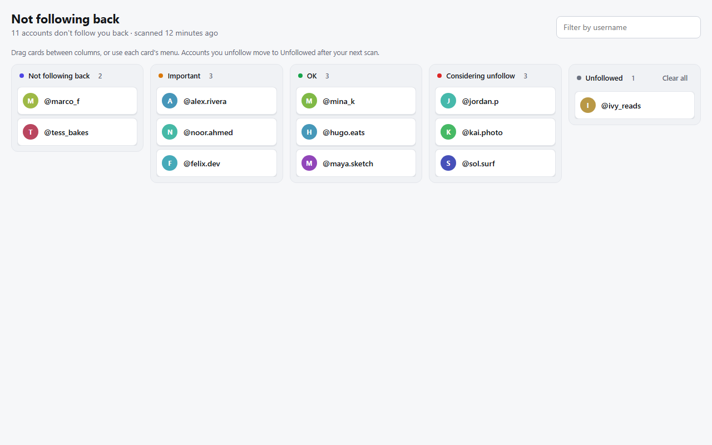

# InstaTrack

A Chrome extension that shows who followed and unfollowed your Instagram account, and helps you sort the accounts that don't follow you back.



## Features

- **Unfollowers and new followers** since your previous scan
- **Counts:** followers, following, not following back
- **Board** for accounts that don't follow you back, with columns for Important, OK, Considering unfollow and Unfollowed
  - Move cards by dragging, or with the menu on each card (works by keyboard too)
  - Accounts you unfollow move to *Unfollowed* automatically after your next scan
- **Filter** the board by username
- Light and dark mode

## Install

1. Download `instatrack-extension-<version>.zip` from the [latest release](../../releases/latest) and unzip it.
2. Open `chrome://extensions` and turn on **Developer mode** (top right).
3. Click **Load unpacked** and choose the unzipped folder.

## Use

1. Open [instagram.com](https://www.instagram.com) and log in.
2. Click the InstaTrack icon in the toolbar, then **Scan followers**. It takes about a minute per 1,000 accounts.
3. Scan again later to see what changed. Click **Review … not following back** to open the board.

## Privacy and safety

- Everything stays in your browser (`chrome.storage.local`). Nothing is sent anywhere except Instagram itself.
- No password needed: it uses the Instagram session already open in your tab, and only reads your own followers and following lists, only when you click Scan.
- Scans pause 1.5–3 seconds between pages and stop at the first error instead of retrying, to avoid tripping Instagram's rate limits.
- Permissions:
  - `activeTab` and `scripting` run the scan in your Instagram tab when you click.
  - `storage` and `unlimitedStorage` keep your scan history (the last 20 scans) and your board.

**Use at your own risk.** InstaTrack reads Instagram's internal web API, which Instagram's terms don't allow. Scanning very large accounts often may get your account temporarily rate-limited.

InstaTrack is an independent project and is not affiliated with, endorsed by or sponsored by Instagram or Meta.

## Development

No build step: load this folder with **Load unpacked**.

```
node diff.test.js                                         # tests for the scan comparison and board logic
powershell -ExecutionPolicy Bypass -File build-extension.ps1   # builds dist/instatrack-extension-<version>.zip
```
